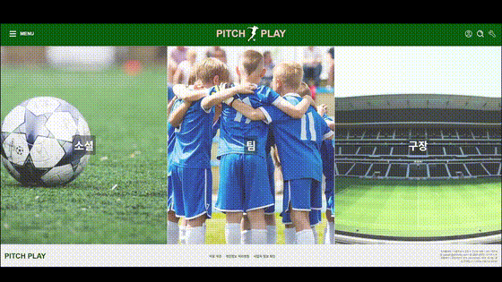

# Developer Portfolio
### Web Frontend · Full-stack Projects

React 기반 웹 UI 구현부터 Spring Boot API 및 데이터베이스 연동까지, 직접 참여한 개발 프로젝트를 정리한 포트폴리오입니다.

---

## Projects

### ⚽ PitchPlay | 축구 팀 매칭 웹 플랫폼
**팀 프로젝트 · React 프론트엔드 개발 참여**

반응형 메인 화면, 마이페이지, 팀 매칭, 팀 컬렉션, 공통 헤더·푸터를 담당했습니다.

**[프로젝트 상세 보기](projects/PitchPlay/README.md)** · **[원본 팀 프로젝트 소스코드](https://github.com/poqazpoqaz/pitchplay)**

### 🚀 Team-Mate | 웹 기반 협업 관리 플랫폼
**캡스톤 프로젝트 · 개발 진행 중**

React, Spring Boot, MySQL 기반의 팀·업무·일정 관리 플랫폼입니다. 프로젝트 정리 및 시연 자료를 추후 추가할 예정입니다.

---

## Tech Stack

**Frontend** · React · JavaScript · HTML · CSS

**Backend / Database** · Java · Spring Boot · JPA · MySQL

> 기술 스택은 참여 프로젝트 전반을 기준으로 작성했습니다. 프로젝트별 담당 범위는 각 상세 페이지에서 구분합니다.

---

## About this portfolio

- 팀 프로젝트의 원본 저장소는 수정하지 않고 링크로 연결합니다.
- 시연 화면은 직접 담당한 기능을 중심으로 정리합니다.
- 새로운 프로젝트를 완성할 때마다 상세 페이지를 추가합니다.
