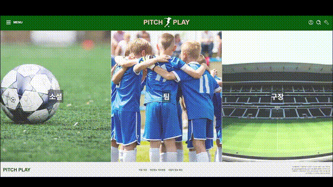
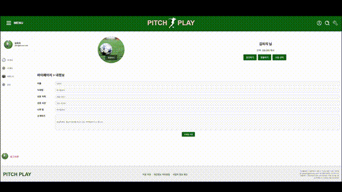
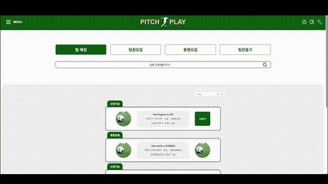

# ⚽ PitchPlay
### React 기반 축구 팀 매칭 웹 플랫폼

[← 포트폴리오 메인으로](../../README.md) · [원본 팀 프로젝트 저장소](https://github.com/poqazpoqaz/pitchplay)

## 프로젝트 소개

축구 팀과 이용자의 팀 활동 및 매칭을 지원하는 웹 플랫폼입니다. 여러 명이 함께 개발한 **팀 프로젝트**로, 이 페이지에서는 제가 담당한 **프론트엔드 화면과 기능**을 중심으로 소개합니다.

**담당 영역:** 마이페이지 · 팀 매칭 · 팀 컬렉션 · 반응형 메인 화면 · 공통 헤더/푸터  
**주요 기술:** React · JavaScript · CSS Modules · React Router · Axios

## 주요 구현 화면

### 📦 전체 시연 영상

편집되지 않은 원본 시연 영상은 아래 압축 파일을 통해 확인할 수 있습니다.

📥 [전체 시연 영상 다운로드](./videos/PitchPlay_전체시연영상.zip)

### 01. 메인 페이지

반응형 레이아웃과 동적인 화면 요소를 구현했습니다. PC와 작은 화면에서의 레이아웃 구성을 고려했습니다.

### 02. 마이페이지

사용자 정보, 활동 내역, 커뮤니티 및 설정 등 개인 영역을 화면별로 구성했습니다.

### 03. 팀 매칭

팀 매칭 목록을 보여주고, 조건에 따른 필터링·정렬 및 목록 표시 기능을 구성했습니다.

### 04. 팀 컬렉션

팀 목록을 조회하고 정렬·필터링하는 화면과 팀 가입 요청 관련 UI를 구성했습니다.

### 05. 공통 레이아웃

여러 화면에서 사용하는 헤더와 푸터를 공통 UI로 구성했습니다.

> GIF는 시연 영상 일부를 추출한 미리보기입니다.

## 기술 구현

| 구분 | 구현 내용 | 관련 코드 |
|---|---|---|
| **페이지 구성** | React Router의 `Outlet`을 활용해 공통 레이아웃 안에서 하위 화면을 표시 | `pages/Main/Main.jsx`, `pages/Mypage/Mypage1/Mypage.jsx` |
| **마이페이지** | 사이드바와 본문 영역을 분리하고, 사용자 상태에 따라 프로필 및 활동 정보를 표시 | `pages/Mypage/`, `stores/UserStore/` |
| **데이터 조회** | Axios로 사용자·매칭·팀 데이터를 읽어와 React 상태에 반영 | `pages/Mypage/Mypage1/Mypage.jsx`, `pages/TeamMatchings/TeamMatchings.jsx`, `pages/TeamCollections/TeamCollections.jsx` |
| **목록 상호작용** | `useState`·`useEffect`를 활용해 필터링, 정렬, 표시 개수, 모달 상태를 관리 | `pages/TeamMatchings/TeamMatchings.jsx`, `pages/TeamCollections/TeamCollections.jsx` |
| **반응형 레이아웃** | CSS Grid와 미디어 쿼리로 화면 너비에 따른 공통 레이아웃을 조정 | `pages/Main/Main.module.css` |
| **공통 UI** | 헤더·푸터를 페이지 레이아웃에 배치하고 링크를 React Router로 연결 | `pages/Main/Main.jsx`, `pages/Footer/Footer.jsx` |

> 위 기술 설명은 보관 중인 프론트엔드 소스코드 기준입니다. 일부 데이터 조회는 `public/data/*.json` 더미 데이터를 사용하며, 이를 실제 운영 서버 연동으로 표현하지 않았습니다.

## 소스코드

[PitchPlay 원본 GitHub 저장소 보기](https://github.com/poqazpoqaz/pitchplay)
